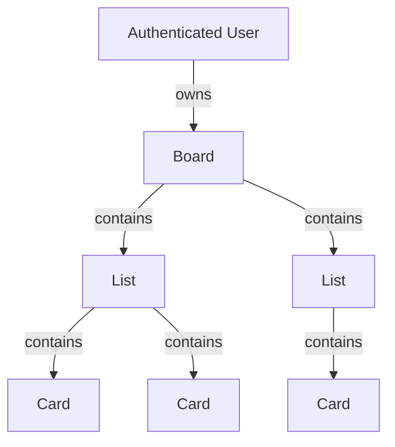

# Phase 2 — Detailed Boards, Lists, and Cards Implementation

## 1. Purpose

Phase 2 turns the Phase 1 authentication foundation into a usable project-management data model. Users can now create project boards, divide each board into workflow lists, and place task cards inside those lists.

The relationship is hierarchical:



```text
User
  └── Board
        ├── List: Backlog
        │     ├── Card: Design homepage
        │     └── Card: Write API specification
        └── List: In Progress
              └── Card: Build registration form
```

There is no team or collaboration model in Phase 2. `Board.ownerId` directly identifies the user who owns the board.

## 2. What the terms mean

### Board

A board represents one project or workspace. Examples are `Website Redesign`, `Marketing Campaign`, or `Mobile App Launch`.

A board has:

- `id`: unique UUID
- `ownerId`: ID of the authenticated user who owns it
- `title`: project name
- `description`: optional project summary
- `createdAt` and `updatedAt`: lifecycle timestamps
- `lists`: relationship to workflow lists

A board is the top-level resource. Ownership is stored directly on the board, so the backend can answer “Does this user own this board?” without trusting request-body data.

### List

A list represents one stage or category of work on a board. Examples are `Backlog`, `To Do`, `In Progress`, `In Review`, and `Done`.

A list has:

- `id`: unique UUID
- `boardId`: parent board
- `title`: stage name
- `position`: integer used to preserve display order
- `createdAt` and `updatedAt`
- `cards`: relationship to cards in that list

A list belongs to exactly one board. Deleting a list cascades and deletes every card stored in that list.

### Card

A card represents one task or work item. Examples are `Create wireframes`, `Fix login validation`, or `Prepare launch checklist`.

A card has:

- `id`: unique UUID
- `listId`: list containing the card
- `title`: required task name
- `description`: optional detail
- `priority`: `LOW`, `MEDIUM`, or `HIGH`
- `dueDate`: optional date and time
- `labels`: PostgreSQL string array
- `position`: integer used to preserve display order
- `createdAt` and `updatedAt`

A card belongs to exactly one list. Deleting a card removes only that card. Moving a card between lists is not implemented in this phase.

## 3. Database architecture

Phase 2 preserves the existing `User` and `RefreshToken` authentication models and adds these models:

```prisma
model Board {
  id          String   @id @default(uuid())
  ownerId     String
  title       String
  description String?
  createdAt   DateTime @default(now())
  updatedAt   DateTime @updatedAt
  owner       User     @relation(fields: [ownerId], references: [id], onDelete: Cascade)
  lists       List[]

  @@index([ownerId])
  @@index([createdAt])
}

model List {
  id        String   @id @default(uuid())
  boardId   String
  title     String
  position  Int
  createdAt DateTime @default(now())
  updatedAt DateTime @updatedAt
  board     Board    @relation(fields: [boardId], references: [id], onDelete: Cascade)
  cards     Card[]

  @@unique([boardId, position])
  @@index([boardId, position])
}

model Card {
  id          String       @id @default(uuid())
  listId      String
  title       String
  description String?
  priority    CardPriority @default(MEDIUM)
  dueDate     DateTime?
  labels      String[]     @default([])
  position    Int
  createdAt   DateTime     @default(now())
  updatedAt   DateTime     @updatedAt
  list        List         @relation(fields: [listId], references: [id], onDelete: Cascade)

  @@unique([listId, position])
  @@index([listId, position])
  @@index([dueDate])
}

enum CardPriority {
  LOW
  MEDIUM
  HIGH
}
```

The migration name is `20261120182258_add_boards_lists_cards`. Its SQL creates:

- The `CardPriority` PostgreSQL enum.
- `Board`, `List`, and `Card` tables.
- Primary-key, foreign-key, position, owner, and due-date indexes.
- Unique `(boardId, position)` and `(listId, position)` constraints.
- Cascading delete foreign keys.

The cascading chain is:

```text
Deleting a User deletes owned Boards
  deleting a Board deletes its Lists
    deleting a List deletes its Cards
```

## 4. Backend module structure

```text
modules/boards/
  board.routes.ts
  board.controller.ts
  board.service.ts
  board.schemas.ts

modules/lists/
  list.routes.ts
  list.controller.ts
  list.service.ts
  list.schemas.ts

modules/cards/
  card.routes.ts
  card.controller.ts
  card.service.ts
  card.schemas.ts
```

The responsibilities follow the existing architecture:

```text
Express route
  -> authenticateUser middleware
  -> Zod validation middleware
  -> controller
  -> service
  -> Prisma
  -> Neon PostgreSQL
```

The controller converts service results into the common API response format. Services contain database queries and authorization decisions. Routes contain no Prisma operations.

## 5. Authentication on private endpoints

Each board, list, and card router executes `authenticateUser` before handling the route.

The middleware:

1. Reads `Authorization: Bearer <access-token>`.
2. Verifies the JWT signature and expiration.
3. Reads the user UUID from the verified `sub` claim.
4. Loads the user through Prisma.
5. Stores the public user object on `req.user`.

The frontend service sends the access token with every protected CRUD request. The route's URL or body never determines who owns a resource.

## 6. Request validation

`board.schemas.ts` validates board title and description values.

`list.schemas.ts` validates list titles.

`card.schemas.ts` validates:

- Required card title.
- Optional description.
- Priority only as `LOW`, `MEDIUM`, or `HIGH`.
- Optional ISO date-time for `dueDate`.
- A labels array containing at most 20 string labels.

Zod normalizes and validates the body before the controller runs. Invalid input receives `400` through centralized error handling.

Example create-card body:

```json
{
  "title": "Write integration tests",
  "description": "Cover board and authorization flows",
  "priority": "HIGH",
  "dueDate": "2026-12-01T12:00:00.000Z",
  "labels": ["Backend", "Testing"]
}
```

The backend stores the `dueDate` as a PostgreSQL `DateTime`. The frontend sends an ISO string and receives an ISO-compatible timestamp from Prisma JSON serialization.

## 7. Board API implementation

```text
POST   /api/boards
GET    /api/boards
GET    /api/boards/:boardId
PATCH  /api/boards/:boardId
DELETE /api/boards/:boardId
```

### Create board

A React request to `POST /api/boards` contains only title and description. It must not contain `ownerId`.

The flow is:

```text
boardRouter
  -> authenticateUser
  -> validate(createBoardSchema)
  -> createBoard controller
  -> boardService.createBoard(req.user.id, req.body)
  -> prisma.board.create
```

`ownerId` is assigned from `req.user.id`, so a client cannot create a board owned by someone else.

### List boards

`getBoards(userId)` uses:

```prisma
where: { ownerId: userId }
orderBy: { createdAt: 'desc' }
```

Only boards owned by the authenticated user are returned.

### Get board detail

`getBoard(boardId, userId)` first calls `requireOwnedBoard(boardId, userId)`.

It then loads:

- The board itself.
- Lists ordered by `position ASC`.
- Cards inside each list ordered by `position ASC`.

The Prisma query includes nested lists and cards in one service operation.

### Update board

`requireOwnedBoard` runs before `prisma.board.update`. Only title and description can be updated through the board schema.

### Delete board

The service verifies ownership, then deletes the board. The database foreign keys cascade to all child lists and cards.

## 8. List API implementation

```text
POST   /api/boards/:boardId/lists
GET    /api/boards/:boardId/lists
PATCH  /api/lists/:listId
DELETE /api/lists/:listId
```

### Create list

For `POST /api/boards/:boardId/lists`:

1. `requireOwnedBoard(boardId, userId)` prevents use of someone else's board.
2. Prisma finds the maximum current list position for that board.
3. The new position is `(maximum ?? -1) + 1`.
4. Prisma creates the list.

This means the first list position is `0`, followed by `1`, `2`, and so forth.

### Get lists

The service again verifies the board belongs to the user, then queries lists by `boardId` and sorts `position ASC`.

### Rename or delete list

`requireOwnedList(listId, userId)` prevents a user from manipulating another person's list. It follows the relation chain:

```text
List.id
  -> List.board
  -> Board.ownerId
```

After ownership succeeds, rename updates only `title`. Delete removes the list and cascades its cards.

## 9. Card API implementation

```text
POST   /api/lists/:listId/cards
GET    /api/lists/:listId/cards
GET    /api/cards/:cardId
PATCH  /api/cards/:cardId
DELETE /api/cards/:cardId
```

### Create card

For `POST /api/lists/:listId/cards`:

1. `requireOwnedList(listId, userId)` verifies the complete list-to-board ownership chain.
2. Prisma finds the maximum card position within the list.
3. The new card position is `(maximum ?? -1) + 1`.
4. The service applies defaults:
   - `priority`: `MEDIUM`
   - `description`: `null`
   - `dueDate`: `null`
   - `labels`: `[]`

### Fetch cards

`getCards(listId, userId)` verifies list ownership and returns cards in ascending position order.

### Get, update, or delete one card

`requireOwnedCard(cardId, userId)` follows:

```text
Card.id
  -> Card.list
  -> List.board
  -> Board.ownerId
```

This prevents a user from accessing a card only by guessing its UUID. Update changes only the fields submitted and can clear `description`, `dueDate`, or `labels` with explicit values. Delete removes only that card.

## 10. Ownership and status codes

Cross-user resources return `404 Not Found` rather than `403 Forbidden` for board detail/list/card operations. This does not disclose whether another user's resource exists.

The API uses:

- `201` for successful board, list, and card creation.
- `200` for successful reads, updates, and deletes.
- `400` for invalid Zod request data.
- `401` for missing or invalid access tokens.
- `404` for missing or inaccessible resources.
- `409` for conflicts such as duplicate constraints.
- `500` for unexpected server errors, without exposing Prisma internals.

User ID fields are never taken from bodies or query parameters for ownership decisions.

## 11. Position management

Position values are application-maintained integers. A new list or card is appended to the end of its parent collection.

Example board state:

```text
position 0: Backlog
position 1: In Progress
position 2: Done
```

Example card state:

```text
position 0: Design header
position 1: Add product images
position 2: Write footer copy
```

List and card APIs sort ascending by position. Database unique constraints prevent duplicate positions inside the same parent.

Phase 2 does not implement drag-and-drop or moving/reordering records, even though the `position` field prepares the application for Phase 3.

## 12. Frontend architecture

Frontend CRUD functionality is split into:

- `pages/DashboardPage.tsx`
- `pages/BoardDragPage.tsx`
- `components/CardModal.tsx`
- `services/boardService.ts`
- `services/cardService.ts`
- `services/api.ts`
- `context/AuthContext.tsx`

React components do not contain Prisma or SQL. They call typed service functions, which call the existing authenticated fetch client.

`apiRequest`:

- Sends requests to `VITE_API_URL`.
- Adds `Authorization: Bearer <access-token>`.
- Uses `credentials: include` for refresh cookies.
- Throws the backend's public error message for non-success responses.

## 13. Dashboard implementation

`DashboardPage.loadBoards` calls `GET /api/boards` after the access token becomes available.

While loading, it renders skeleton boxes. If no boards are returned, it renders an empty state. API failures appear in the error banner.

### Create or edit board

`submit` chooses create or update based on `editing`:

```text
editing == null -> POST /api/boards
editing != null -> PATCH /api/boards/:boardId
```

After success, React updates the `boards` array without refreshing:

- Create prepends the response board.
- Update maps over the array and replaces the matching board.

### Delete board

Delete requires browser confirmation, calls `DELETE /api/boards/:boardId`, and filters the deleted board out of local state.

## 14. Board view implementation

Opening `/boards/:boardId` calls `BoardDragPage.loadBoard`.

It calls:

```text
GET /api/boards/:boardId
```

The response contains the board, nested lists, and nested cards. The page stores that data in `board` state.

### Create list

`addList` calls `POST /api/boards/:boardId/lists`. On success, it appends the returned list with `cards: []` to local state.

### Rename list

`renameList` calls `PATCH /api/lists/:listId`. It replaces only the matching list title in local state.

### Delete list

`removeList` asks for confirmation and calls `DELETE /api/lists/:listId`. It removes the list and all cards it held from local state.

### Create or update card

`saveCard` in `BoardDragPage` chooses the operation:

```text
modalCard exists -> PATCH /api/cards/:cardId
modalCard is null -> POST /api/lists/:listId/cards
```

Create appends the card to the selected list. Update replaces the matching card in that list.

### Delete card

`deleteModalCard` calls `DELETE /api/cards/:cardId`, then filters the card out of every list in local state.

## 15. Card modal implementation

`CardModal` maintains local form state for:

- Title.
- Description.
- Priority.
- Due date.
- Label input.
- Existing labels.
- Saving and error status.

The modal can run in either create or edit mode:

- `card === null`: create mode.
- `card` contains a record: edit mode.

Labels are added locally and removed before save. The final labels array is sent to the backend.

The card component displays:

- Title.
- Description preview.
- Priority indicator.
- Due date when opened through the modal.
- Labels.

## 16. Complete board creation example

### Example

A logged-in user creates `Website Redesign`.

```http
POST /api/boards
Authorization: Bearer <access-token>
Content-Type: application/json

{
  "title": "Website Redesign",
  "description": "Complete the 2026 website refresh"
}
```

The backend creates:

```text
Board
  id: board-1
  ownerId: logged-in-user-id
  title: Website Redesign
  description: Complete the 2026 website refresh
```

The user creates `Backlog`:

```text
POST /api/boards/board-1/lists
{ "title": "Backlog" }
```

The backend assigns position `0`.

The user creates `In Progress`:

```text
POST /api/boards/board-1/lists
{ "title": "In Progress" }
```

The backend assigns position `1`.

The user creates a card in Backlog:

```text
POST /api/lists/list-backlog/cards

{
  "title": "Review homepage layout",
  "description": "Review desktop and mobile concepts",
  "priority": "HIGH",
  "dueDate": "2026-12-10T12:00:00.000Z",
  "labels": ["Design", "Homepage"]
}
```

The card receives position `0` in Backlog.

Refreshing the browser and opening the board later loads the same records from Neon PostgreSQL, with lists and cards sorted by position.

## 17. Complete frontend mutation lifecycle

```text
User action
  -> React event handler
  -> board/card/list typed API service
  -> apiRequest
  -> Authorization Bearer header
  -> Express route
  -> authenticateUser
  -> Zod validation
  -> controller
  -> Prisma service
  -> Neon PostgreSQL
  -> JSON success response
  -> update React state
  -> UI immediately reflects the mutation
```

For an error, the backend returns a public JSON error, `apiRequest` throws that message, and the component displays it in an inline error area or alert.

## 18. Automated verification

Phase 2 integration coverage is in `apps/backend/tests/phase2.test.ts` and verifies:

- Board create, list, detail, update, and delete.
- Board isolation between users.
- List create, fetch, rename, delete, and position order.
- List creation in another user's board is denied.
- Card create, fetch, update, delete, and position order.
- Card access by another user is denied.
- Cascading board/list deletion behavior.

Vitest configuration allows 30 seconds for Neon-backed setup and test operations.

The current build and live database test results:

- Backend build passes.
- Frontend build passes.
- Three test files pass.
- Ten tests pass.

## 19. Phase 2 limitations

Phase 2 intentionally excludes:

- Drag-and-drop.
- Moving cards between lists.
- Reordering lists or cards.
- Automatic access-token refresh before protected API requests.
- Team membership or shared boards.
- Real-time updates.
- Role-based permissions.
- AI summaries.

The `position` fields and ordered API responses prepare the schema for drag-and-drop and persisted reordering in Phase 3.
